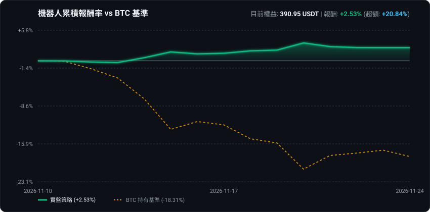

# Bybit 交易機器人(模擬交易階段)

<!-- BOT_DASHBOARD_START -->
## 📊 機器人實盤績效走勢

[👉 點此開啟即時互動儀表板 (GitHub Pages)](https://tedmax100.github.io/bybit_trading_bot/)



| 指標 | 數值 | 說明 |
| :--- | :---: | :--- |
| **目前總權益** | **`390.95 USDT`** | 起始本金 `381.29 USDT` |
| **累計淨損益** | **`+9.66 USDT` (`+2.53%`)** | 扣除所有手續費與融資成本之淨值 |
| **同期 BTC 報酬** | **`-19.03%`** | 同期買入並持有比特幣表現 |
| **超額報酬 (Alpha)**| **`+21.56%`** | 策略相對於 BTC 的超額增益 |
| **歷史最大回撤** | **`-0.87%`** | 運行期間內資產自高點最大拉回幅度 |
| **永續短線 (4H)** | **勝率 `100%` / 已實現 `+13.55 USDT`** | 4 戰 4 勝，爆倉 0 次 |

### 📝 近 7 日交易與調倉日誌

| 時間 (UTC) | 市場 | 標的 | 交易動作 | 損益 / 名目額 | 觸發原因 |
| :--- | :---: | :---: | :--- | :---: | :--- |
| `2026-11-22 16:00` | 永續短線 | `BTCUSDT` | 平倉 空 @60720.7 | **`+2.98 USDT`** | 持有滿 5 天 |
| `2026-11-22 12:00` | 永續短線 | `ETHUSDT` | 平倉 空 @1719.55 | **`+0.46 USDT`** | 收盤 1718.43 突破 2 日高 1708.31 |

*最後自動更新時間：`2026-11-28 08:12 UTC`*
<!-- BOT_DASHBOARD_END -->


求穩優先的 Bybit 現貨機器人。目前**只做本機模擬交易**,不會送出任何真實訂單。

## 常用指令

```bash
# 查看模擬交易成效(每日權益、累計報酬、同期 BTC 買進持有、回撤、當天動作)
.venv/bin/python main.py report

# 執行今日模擬交易(每個 UTC 日只會真正執行一次;--force 強制重跑)
.venv/bin/python main.py run [--force]

# 回測 / 檢查
.venv/bin/python main.py backtest BTCUSDT 730   # 趨勢策略回測(公開資料)
.venv/bin/python main.py gate BTCUSDT           # 今日永續閘門是否開放
.venv/bin/python main.py budget                 # 讀帳戶權益並結算今日額度(需 API key)

# 測試
.venv/bin/python -m pytest -q
```

## 排程

已在本機 crontab 設定每小時第 5 分鐘執行 `main.py run`,輸出寫到 `data/run.log`。
任務是冪等的:同一個 UTC 日只執行一次,電腦關機漏跑,開機後下一個整點會補跑。
停止排程:`crontab -e` 刪掉含 `bybit_trading_bot` 的那一行。

## 怎麼看績效與報酬

- 問 Claude:在這個目錄開 Claude Code,直接說「看一下實盤績效」或輸入 `/bot-report`(技能定義在 `.claude/skills/bot-report/SKILL.md`)。
- 自己看:

```bash
# 實盤
gcloud storage cp gs://bybit-bot-909483-bybit-bot-state/live.db data/live.db
DB_PATH=data/live.db .venv/bin/python main.py perf      # 當日/7/20/30/60/90/180/360 日
DB_PATH=data/live.db .venv/bin/python main.py report    # 每天一列
# 模擬
gcloud storage cp gs://bybit-bot-909483-bybit-bot-state/bot.db data/bot.db
.venv/bin/python main.py perf
.venv/bin/python main.py report
```

`perf`:各期間的損益金額、報酬率、同期直接持有 BTC 的報酬、期間內最大回撤;終點是現在(即時價格),起點是 N 天前那次執行的紀錄,紀錄不足會標示。期間內的入金/出金會被算成損益。
`report`:每天一列,權益、累計報酬、同期直接持有 BTC 的報酬、回撤、當天動作。「權益」不含帳戶原有的零頭,會與 Bybit App 的總資產差一點。

## 雲端執行(GCP 台灣區域,選配)

本機沒開就會漏跑,所以可改用 Cloud Scheduler 定時喚醒 Cloud Run Job(跑完即關,用量在免費額度內)。

- `Dockerfile` / `.dockerignore`:只打包 `bot/`、`main.py`、`cloud_run.py`;`.env`、金鑰、`data/` 都不會進映像。
- `cloud_run.py`:容器入口。執行前從 Cloud Storage 取回 `bot.db`,跑完傳回;當天已執行過就不上傳。
  上傳帶版本條件,兩個執行撞在一起時後者會失敗而不是覆蓋。bucket 沒有狀態檔時預設拒絕執行(`STATE_INIT=1` 才允許從頭開始)。
- `deploy/gcp.sh`:建 bucket、映像、Job、排程的 `gcloud` 指令(區域 `asia-east1`),需自行登入後逐段執行。
- **2026-11-10 部署 / 2026-11-12 調整**: 專案 `bybit-bot-909483`, Job `bybit-bot-daily`, 排程每 4 小時觸發一次 (`10 */4 * * *` UTC)。現貨仍是**每天只決策一次**(其餘觸發會略過);永續短線每 4 小時決策一次。狀態在 `gs://bybit-bot-909483-bybit-bot-state/bot.db`。三段式退場防護盾與 4H EMA 濾網回測為負(換手暴增),**預設關閉**(`EXIT_SHIELD=0`、`EMA_SHORT=0`、`TIMEFRAME=D`)。本機 crontab 已註解停用。
- 看成效:`gcloud storage cp gs://bybit-bot-909483-bybit-bot-state/bot.db data/bot.db && .venv/bin/python main.py report`
- 改程式後重新部署:`gcloud builds submit --tag asia-east1-docker.pkg.dev/bybit-bot-909483/bybit-bot/bot:latest .`(Job 用 `latest` 標籤,下次執行即生效)
- 本機測試映像:`docker build -t bybit-bot:local . && docker run --rm bybit-bot:local python main.py run`
- 雲端與本機 crontab 不可同時啟用,否則兩邊會各有一份狀態。

### 實盤(真錢,2026-11-10 建立)

另一個 Job `bybit-bot-live` 用同一個映像跑真錢現貨交易,與模擬 Job 完全分開(狀態檔 `live.db`,兩種狀態檔混用會直接拒絕執行)。

- 設定(Job 環境變數):`LIVE=1`、`BYBIT_ENV=mainnet`、`BUDGET_PCT=0.5`(動用帳戶 50%)、`SLEEVE=BTCUSDT:0.7,ETHUSDT:0.3`、`STATE_OBJECT=live.db`。金鑰來自 Secret Manager(`bybit-api-key`、`bybit-rsa-key`)。
- `bot/live.py`(`BybitBroker`):只下現貨市價單;只賣機器人自己買的量,帳戶原有的幣不動;不做套利、不碰合約。
- 每筆單帶固定編號 `bybot-日期-幣-B/S`,同一天重跑不會重複下單;每次開跑先對帳(補回漏記的成交、持倉不超過帳戶實際餘額)。
- 熔斷:持倉虧損達當日額度的 30% 時全部賣出,每天只在執行那一次檢查。
- 第一次啟用:`gcloud run jobs execute bybit-bot-live --region=asia-east1 --update-env-vars=STATE_INIT=1 --wait`,確認成功後 `gcloud scheduler jobs resume bybit-bot-live-trigger --location=asia-east1`。
- 看實盤紀錄:`gcloud storage cp gs://bybit-bot-909483-bybit-bot-state/live.db data/live.db && DB_PATH=data/live.db .venv/bin/python main.py report`
- 緊急停止:`gcloud scheduler jobs pause bybit-bot-live-trigger --location=asia-east1`(持倉要自己在 Bybit 賣,或用 `sell_to_usdt.py`)。
- `sell_to_usdt.py`:把帳戶裡的非穩定幣市價賣成 USDT(預設只預覽,`--execute` 才下單)。

## 資金與風控規則

- 每日 UTC 00:00 以總權益 × **5%** 為當日可動用資金(是動用的資金,不是虧損上限),所有策略共用。
- 單日虧損達可用資金的 **30%** 即熔斷:全部平倉,當天不再開新倉。賣出永遠允許。
- 標的白名單(`bot/config.py`):BTC、ETH、LINK、XRP、SOL、ENA、AAVE。**不碰迷因幣**。
- 單筆最小下單額 5 USDT。永續合約優先序最低,槓桿上限 2 倍,且須通過「永續閘門」。
- 風控由 `GuardedBroker`(`bot/broker.py`)在下單層強制執行,策略繞不過。

## 目前跑的策略(模擬交易)

**現行跑 D:趨勢分數 × 波動目標**(2026-11-10 起,取代 200 日均線濾網);資金費率套利為選配,預設停用(`FA_ENABLED=1` 才啟用,關閉時若有套利持倉會自動平倉)。
套利停用理由:含基差、強平、置中的較真實回測約 2.4%/年,與放現金相差無幾,卻要多承擔永續合約與雙腿下單風險。

額度分配:

1. **趨勢分數 × 波動目標(50%)**:BTC 佔額度 35%、ETH 佔 15%。每檔目標部位 = 該檔額度 × 趨勢分數 × 波動縮放。
   - 趨勢分數(0~1):收盤站上 50/100/200 日均線、30/90/180 日動能為正,六項中成立的比例。
   - 波動縮放:40% ÷ 近 30 日年化波動,上限 1(不加槓桿)。
   - 目標與現有市值差距小於該檔額度的 5%(且至少 5 USDT)不調整;分數為 0 一律出清。
   - 動作會顯示為 進場 / 加碼 / 減碼 / 出場。
2. **資金費率套利(50%,選配,預設停用)**:BTC、ETH 各 25%。現貨買入 + 永續開等量空單(逐倉 **1.5 倍**,強平約在進場價 +66%),賺 funding。
   - funding 用 Bybit 真實歷史費率,每次執行補入上次以來已結算的部分。
   - 強平用兩次執行之間的小時線最高價檢查;碰到強平價即視為爆倉,保證金歸零。
   - 價格較永續進場價上漲 30% 時,兩條腿一起平倉再重開(重新置中),避免逼近強平價。
   - 熔斷時兩條腿一起平倉。
   - 套利的現貨腿與均線策略的現貨分開記帳,均線出場不會賣到套利的現貨。

另有**觀察模式**(SOL、LINK、AAVE、XRP):只記錄 200 日均線策略的虛擬績效,不佔額度、不下單。
另有**觀察組合**(2026-11-10 起,不下單):用整份虛擬資金(起算 100)並排比較
「舊 均線(BTC70/ETH30)」(200 日均線一刀切,已不是實盤策略)與實盤現行的「D 趨勢分數+波動目標(BTC70/ETH30)」,在 `report` 最下方顯示。
D = 多週期趨勢分數(站上 50/100/200 日均線、30/90/180 日動能為正的比例)× 波動目標 40%(上限 1,不加槓桿),
權重變動小於各檔額度的 5% 不調整。2026-11-14 起多一個「D 同上,調整門檻20%」:從 D 當下的狀態分叉,
只把調整門檻放寬到 20%(回測換手 13.5x → 5.5x),觀察幾週再決定實盤要不要跟進。
`report` 與 `perf` 的「權益」自同日起含永續短線損益(實盤加未實現;模擬另加已實現),額度與熔斷的算法不變。訊號積木在 `bot/strategies/dynamic.py`,兩年回測與參數穩健性用 `.venv/bin/python dyn_run.py [refresh]`。

模擬本金預設 10,000 USDT(環境變數 `PAPER_CAPITAL` 可調)。

## 永續短線(`bot/perp_sleeve.py`,2026-11-12 起,先跑模擬)

小部位、多空都做、每 4 小時決策一次,與現貨分開記帳,在 `report` 最下方顯示。

- 情境濾網:沿用現貨的趨勢分數;分數 ≥ 5/6 才准做多、≤ 1/6 才准做空。
- 進場:4 小時收盤突破前 5 天的最高 / 最低。出場:反向突破前 2 天高低點、趨勢分數翻過 0.5、或持有滿 5 天。
- 部位:每檔固定一口最小下單量(BTC 0.001、ETH 0.01,合計名目約 92 USDT),槓桿 2 倍,不加碼。`PERP_QTY` 可調。
- 開關:`PERP_ENABLED=1` 才會執行(目前只開在模擬 Job)。實盤另需 `PERP_LIVE=1` 才會送單,**尚未啟用**;
  實盤下單(`LiveExec`)只用假的交易所物件測過,還沒對真的交易所下過單。實盤開倉會同時在交易所掛 10% 保護性停損。
- 回測(2022-05~2026-11,含手續費與 funding):更短的純動能(持有 < 2 天)全部虧損;這個版本以固定一口重播最近 2.5 年為
  +36.9 USDT / 165 筆、勝率約 40%、累計損益最大回落 -25.5 USDT、最長連虧 17 筆。獲利幾乎都來自多單,空單接近打平。

## 回測結論摘要(2021~2026,含手續費與滑價)

| 策略 | 結論 |
|---|---|
| 趨勢突破(現貨) | 樣本外有賺但輸買進持有,回撤 -39%~-57%,淘汰 |
| 區間均值回歸(現貨) | 全面虧損,淘汰 |
| 資金費率套利(BTC/ETH) | 年化約 4~5%、回撤約 -1%;近一年 funding 僅 2~3%。山寨幣有空單爆倉風險,不建議 |
| 現貨網格(帶停損,1H) | 不穩健:BTC 24 組參數僅 8 組賺、回撤中位數 -50%;ETH 24 組全虧。樣本外數字被排除第一年熊市而偏好看,且成交順序假設偏樂觀,淘汰(`bot/grid.py`、`grid_run.py`) |
| 200 日均線濾網 | BTC 有效(回撤 -67% → -32%);ETH 勉強;山寨幣無效 |
| 動態策略(`dyn_run.py`,近兩年 vs 前段) | 趨勢分數+波動目標:近兩年年化 +8%、回撤 -23%(現行 +4%、-30%),前段少賺但回撤也較小,參數不敏感 → 列入觀察。雙動能輪動報酬高但回撤 -43%~-72% 且對參數敏感,淘汰 |
| 組合:均線 50% + 套利 50% | 年化約 15%、最大回撤約 -16%;後半段表現明顯轉弱,樣本小 |

換算成整個帳戶(只動用 5%),預期年化僅約 1%,最大回撤約 1%。這是保本取向的組合,不是獲利主力。
**回測不代表未來,也沒有計入基差波動與強平風險。**

## 專案結構

```
main.py                 指令入口
bot/budget.py           每日額度、熔斷(SQLite)
bot/broker.py           Broker 介面、PaperBroker、GuardedBroker(白名單/額度/熔斷)
bot/perp.py             模擬永續空單簿(保證金、funding、強平)
bot/perp_sleeve.py      永續短線(訊號、模擬與實盤執行器、每 4 小時的步驟)
bot/runner.py           每日任務與 report
bot/exchange.py         pybit 包裝(支援 HMAC 與 RSA 簽名)
bot/strategies/         趨勢、均值回歸、均線濾網
bot/funding_arb.py      資金費率套利回測
bot/gate.py             永續閘門
bot/backtest.py、walkforward.py   回測與 walk-forward
data/                   資料庫、快取、日誌(不進版控)
tests/                  單元測試
```

## 尚未完成

- 真實下單的 `BybitBroker`(Testnet 無法建 key,Demo Trading 回報 10024 地區限制)。
- 真實交易所的永續空單下單、保證金追加與強平距離監控(目前只有本機模擬,見 `bot/perp.py`)。
- 重啟後與交易所對帳。
- 代幣化股票(xStocks)僅列為觀察名單:成交量過低、歷史短,未納入。

## API key 與安全

- 使用 RSA 自行生成金鑰:私鑰放在專案外(`~/.bybit/demo_private.pem`,權限 600),
  `.env` 只填路徑(`BYBIT_RSA_KEY_PATH`),`BYBIT_API_SECRET` 留空。範本見 `.env.example`。
- 目前 `.env` 的 key 是 **mainnet** key,`BYBIT_ENV` 刻意維持 `demo`。**未經確認不要對實盤下單。**
- 建議到 Bybit 後台為該 key 綁定 IP 白名單,並關閉用不到的權限(例如子帳號轉帳)。
- 絕對不要開提現權限。Bybit 擋美國與中國大陸 IP。
- `.gitignore` 已排除 `.env`、`*.pem`、`*.db`、`data/`、`.venv/`。目前尚未初始化 git。
